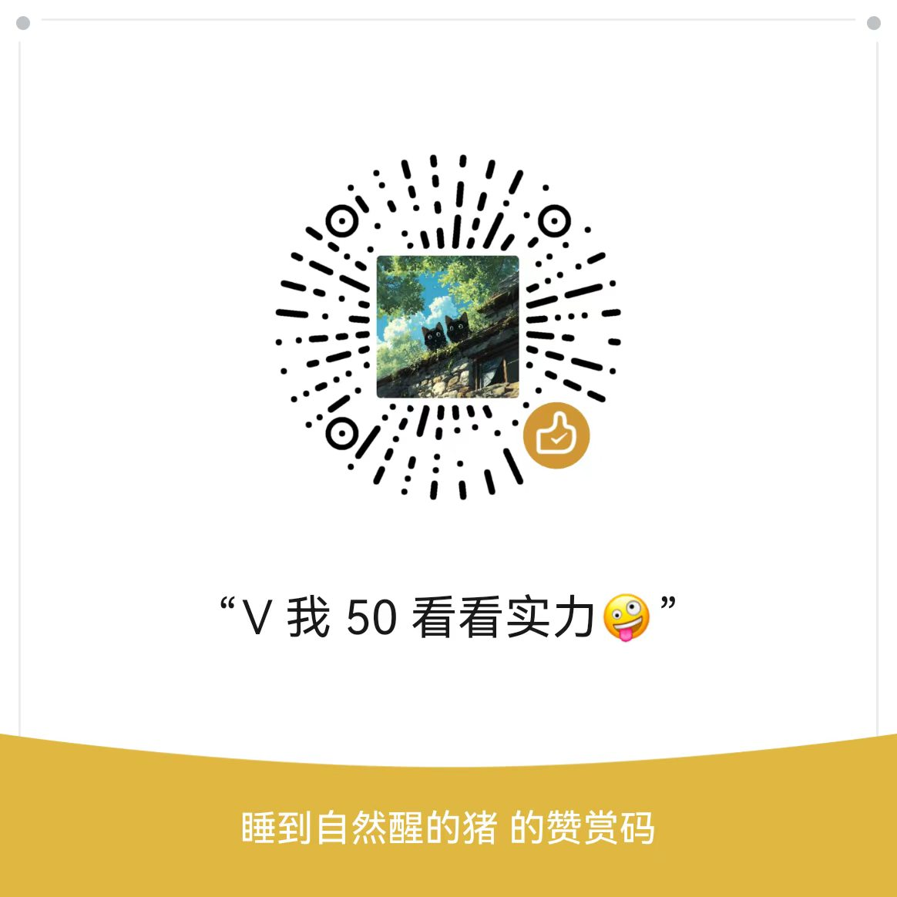

# Hi! I'm iaoexl（睡到人间饭熟时） 👋

这里汇总我公开的学习笔记、兴趣项目和资料整理仓库。内容多源于个人兴趣、学习过程中的归纳，以及从选专业以来对相关考试内容的整理。

## 公开仓库示例

| 仓库 | 说明 |
|---|---|
| Art-of-Communication | 源于一次想法和兴趣点的沟通主题整理 |
| Shan-Yi-Ming-Xiang-Bu | 兴趣驱动的资料整理 |
| ict-certifications | 从选专业开始对相关考试内容的整理归纳 |

> 以上仅为部分示例，仓库会持续补充。

## 内容说明

所有内容均已通过 agent 工具统一格式并清理错误内容，但仍可能存在遗漏，欢迎通过 Issue 反馈。

## 反馈

- 发现问题：欢迎提 Issue
- 建议交流：欢迎讨论

## 你可以在这些地方找到我 (Find Me Here)

  <a href="https://gitcode.com/iaoexl" target="_blank" rel="noopener">
    &nbsp;GitCode
  </a>
  &nbsp;/&nbsp;
  <a href="https://atomgit.com/iaoexl" target="_blank" rel="noopener">&nbsp;AtomGit
  </a>
  &nbsp;&nbsp;
  <a href="https://cnb.cool/u/iaoexl" target="_blank" rel="noopener">
    &nbsp;腾讯云 CNB
  </a>
  &nbsp;&nbsp;
  <a href="https://gitee.com/iaoexl" target="_blank" rel="noopener">
    &nbsp;Gitee
  </a>
  &nbsp;&nbsp;
  <a href="https://github.com/iaoexl" target="_blank" rel="noopener">
    &nbsp;GitHub
  </a>

<!--
## 请我喝杯咖啡

|     微信赞赏码     |       支付宝        |       支付宝红包        |
| :----------------: | :-----------------: | :-----------------: |
|  | | |
-->

## ⚠️ 法律风险与使用限制

> **本仓库不构成法律意见，以下仅为风险提示。**

### 1. 许可状态
除另有单独 LICENSE 文件明确说明外，本仓库内容**不授予任何开源许可证**。根据著作权法默认规则，未声明许可证不等于“可以自由使用”，而是**保留所有权利**。你可以查看、克隆用于个人学习，但**不得**未经许可复制、分发、修改后公开发布，或用于商业目的。

仅在 README 中写一句“禁止商用”**不能替代正式的 LICENSE 文件**；如需明确授权范围，应单独添加 LICENSE。

### 2. 第三方内容的权利归属
仓库中部分内容可能整理、归纳或引用了来自教材、考试大纲、官方资料、课堂材料或其他公开来源的信息。这些第三方内容的著作权**仍归原权利人所有**，本仓库不对其主张任何权利，也不因收录而授予你使用许可。

个人学习、研究范围内使用他人已发表作品，通常属于合理使用；但**将整理后的笔记、题目或资料公开到网络供他人获取，即使不盈利，也可能涉及信息网络传播权**，存在被要求删除或主张侵权的风险。尤其是完整复制习题集、考试原题并公开传播，风险高于少量引用或思路归纳。

### 3. 使用风险自负
本仓库内容按“原样”提供，不附带任何明示或默示的保证，包括准确性、完整性、适用于特定目的或不侵权。因使用或依赖本仓库内容产生的任何后果，作者不承担责任。

### 4. 侵权通知
如果你认为本仓库内容侵犯了你的合法权益，请通过 [你的联系方式/邮箱] 联系，并提供权属证明和具体位置。核实后我会尽快删除或调整相关内容。
